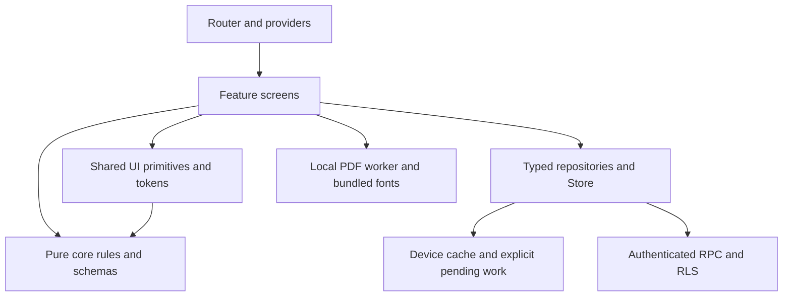

# Architecture and migration boundaries

The app uses React 18, Vite, TypeScript, Zod, TanStack Query and a local Store abstraction. The public website is generated separately and has a locked design. The Pages artifact contains website `/` and native app `/app/`; the old public repository is a redirect.

This describes the intended dependencies and the existing Store path. Direct feature RPC calls still need extraction into `apps/web/src/data/`; it is not claimed that every screen already follows the final boundary. Core may not import React or app code. UI may not import feature internals. Source dependency analysis preserves JSX to avoid treating compiler-injected runtime helpers as authored dependencies.

Shared context types now live outside the main entry. Plan schema/type extraction removes type-only cycles without changing plan behavior or prices. Madge reports zero cycles after that extraction. Component-size, strict typing, CSS and coverage targets remain enforced work.

Auth and tenant authorization are server decisions. Local assistant parsing/preview is not a permission boundary; confirmed actions use existing protected APIs. PDFs and error diagnostics run on-device. Diagnostics contain category/scope/time/severity only; no exception messages, stack traces, URLs or records. Preferences have a guarded compatibility facade and versioned typed API; private records belong to Store, not preference storage.
